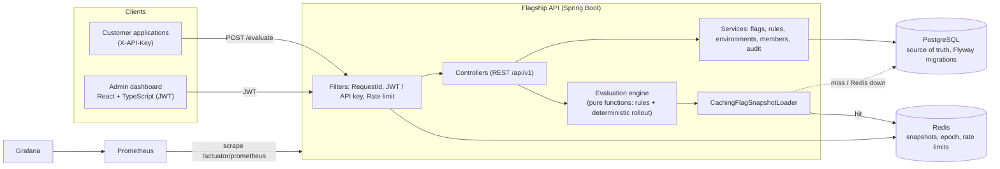
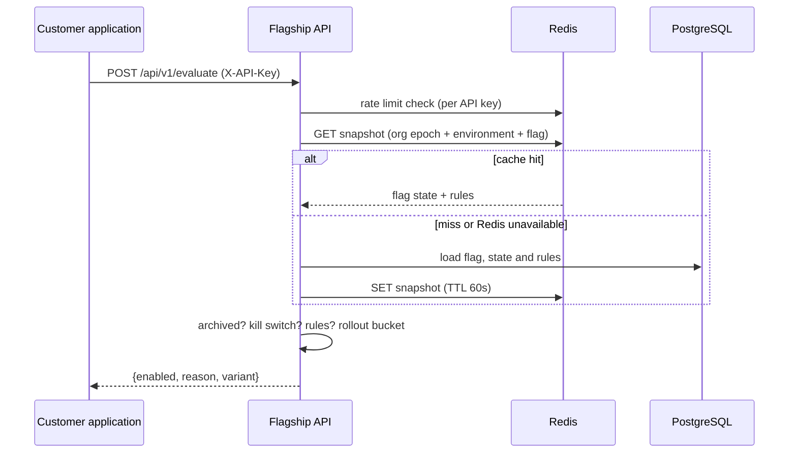
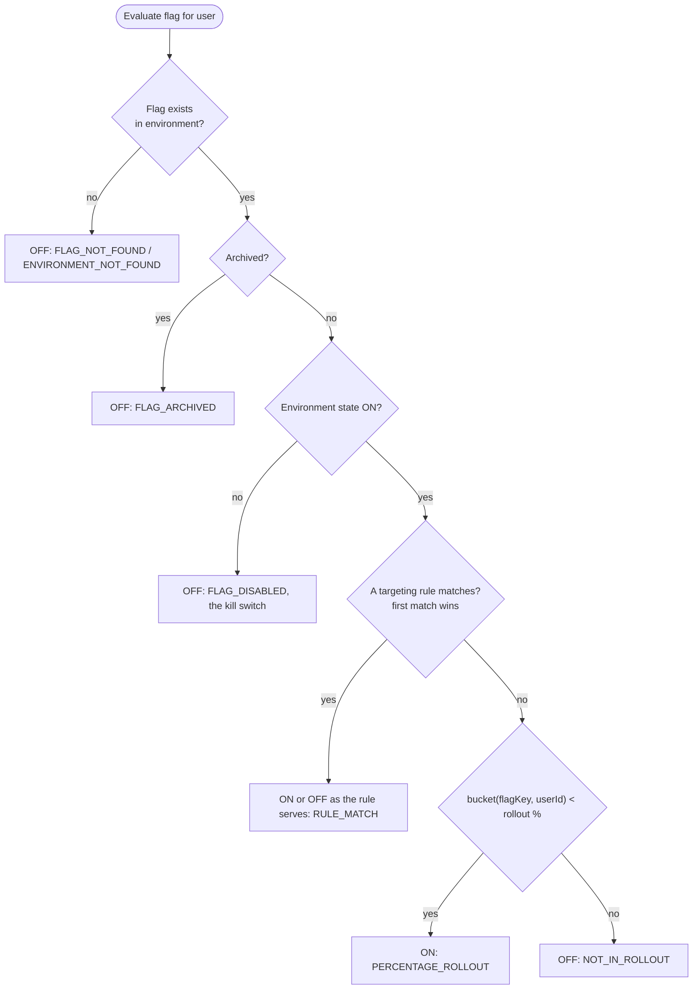
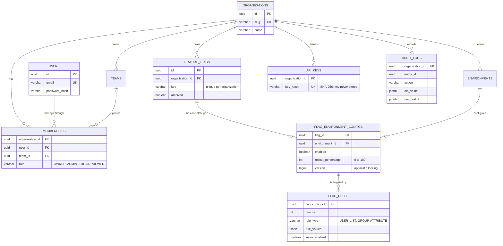

# Flagship

**Enterprise feature flag management platform.** Release features gradually, target the right users and turn anything off in seconds, without a new deploy.

     

## Table of contents

- [Project Overview](#project-overview)
- [Business Problem](#business-problem)
- [Architecture](#architecture)
- [Technology Stack](#technology-stack)
- [Core Features](#core-features)
- [API Documentation](#api-documentation)
- [Database Design](#database-design)
- [Getting Started](#getting-started)
- [Docker Setup](#docker-setup)
- [Testing](#testing)
- [CI/CD](#cicd)
- [Architecture Decisions](#architecture-decisions)
- [Roadmap to Production](#roadmap-to-production)

## Project Overview

Flagship lets development teams control which features are visible in their software **at runtime**. A team creates a flag, decides per environment (development, staging, production) whether it is ON, how many users receive it, and which specific users, groups or attributes are always in or out. Applications ask Flagship one question, "can this user see this feature?", and get an answer in milliseconds.

The project is a multi-tenant SaaS: every organization has its own users, teams, environments, flags and API keys, fully isolated from the others.

It contains:

| Part | Description |
|---|---|
| `backend/` | Spring Boot 3.4 / Java 21 REST API, PostgreSQL, Redis |
| `frontend/` | React + TypeScript admin dashboard |
| `infrastructure/` | Prometheus and Grafana provisioning |
| `docs/` | Architecture Decision Records, validation checklist, production roadmap |
| `.github/` | GitHub Actions pipeline and Dependabot |

## Business Problem

Deploying code and releasing a feature are different things, but without feature flags they are the same event. That coupling causes real problems:

- **Risky releases.** A broken feature reaches 100% of users at once, and the only fix is a rollback deploy.
- **Slow recovery.** Turning a feature off requires a build, a pipeline run and a deploy, when minutes matter.
- **No gradual validation.** Teams cannot expose a feature to 10% of users, watch the metrics and then continue.
- **Long-lived branches.** Unfinished work is kept out of `main` instead of being merged behind a flag.
- **No accountability.** Nobody can answer "who changed this and when?".

Flagship decouples deployment from release. A feature ships dark, is enabled progressively, and can be killed instantly. Every change is recorded in an audit trail.

## Architecture



### Evaluation flow (hot path)



### Evaluation order of precedence



## Technology Stack

| Layer | Technology |
|---|---|
| Language / runtime | Java 21 |
| Backend framework | Spring Boot 3.4, Spring Web, Spring Validation |
| Security | Spring Security, JWT (HS256), API keys, RBAC |
| Persistence | Spring Data JPA, Hibernate, PostgreSQL 16, Flyway |
| Cache and counters | Redis 7 |
| API documentation | springdoc OpenAPI / Swagger UI |
| Frontend | React 18, TypeScript, Vite, React Router, TanStack Query |
| Tests | JUnit 5, Mockito, Testcontainers, JaCoCo |
| Observability | Micrometer, Prometheus, Grafana, structured JSON logs |
| Delivery | Docker, Docker Compose, GitHub Actions, Dependabot |

## Core Features

**Authentication and authorization**
- Registration creates a user and a new organization; the user becomes its OWNER.
- Stateless JWT carrying the user, the organization and the role.
- RBAC with four roles: `OWNER`, `ADMIN`, `EDITOR`, `VIEWER`.
- Organizations and teams. Tenant isolation is enforced from the authenticated token, never from request parameters.

**Feature flags**
- Unique key per organization, name, description, creator and timestamps.
- Independent state per environment: ON/OFF and rollout percentage. New organizations start with `development`, `staging` and `production`; more can be created.
- Soft delete (archive) keeps history meaningful and prevents silent key reuse.
- Optimistic locking: concurrent edits end in `409 Conflict`, not in silently lost changes.

**Progressive rollout**
- Deterministic bucketing: `SHA-256(flagKey:userId) mod 100`. The same user always gets the same answer, raising 10% to 25% only adds users, and no assignment table is stored.

**Targeting rules**
- Ordered list per flag and environment, first match wins, each rule serves ON or OFF.
- Rule types: user list, group, and user attribute with operators `EQUALS`, `NOT_EQUALS`, `IN`, `NOT_IN`, `CONTAINS`, `STARTS_WITH`, `ENDS_WITH`, `GREATER_THAN`, `LESS_THAN`.

**Performance**
- Redis cache-aside for flag snapshots with O(1) per-organization invalidation by epoch, executed after the database commit. If Redis is down, PostgreSQL answers.

**Protection**
- Rate limiting: 20 requests/min per IP on login and register, 3000/min per API key on evaluation, 300/min per user elsewhere. Exceeding answers `429` with `Retry-After`.
- Errors follow RFC 7807 (problem details), with per-field validation messages.

**Audit trail**
- Who, what, when, old value and new value (JSONB snapshots), written in the same transaction as the change.

**Operations**
- Health probes (`liveness`, `readiness` including PostgreSQL and Redis), Prometheus metrics, a provisioned Grafana dashboard and a request id on every response and log line.

**Dashboard**
- Overview with ON/OFF counts per environment, flag list with filters and pagination, visual rollout control, targeting rules editor, an evaluation playground, audit history, environments, members, teams and API keys.

## API Documentation

Interactive documentation: **http://localhost:8080/swagger-ui.html** (OpenAPI JSON at `/v3/api-docs`). All endpoints are under `/api/v1`.

| Area | Endpoint | Who can call |
|---|---|---|
| Auth | `POST /auth/register`, `POST /auth/login` | anyone |
| Flags | `GET /flags` (`search`, `archived`, `environment` + `enabled`, `page`, `size`), `GET /flags/{id}` | any member |
| Flags | `POST /flags`, `PUT /flags/{id}`, `PUT /flags/{id}/environments/{key}` | OWNER, ADMIN, EDITOR |
| Flags | `DELETE /flags/{id}` (archives) | OWNER, ADMIN |
| Rules | `GET /flags/{id}/environments/{key}/rules` | any member |
| Rules | `PUT /flags/{id}/environments/{key}/rules` (replaces the ordered list) | OWNER, ADMIN, EDITOR |
| Environments | `GET /environments` | any member |
| Environments | `POST /environments` | OWNER, ADMIN |
| Evaluation | `POST /evaluate` | application with an API key, or a logged-in user |
| Audit | `GET /audit-logs` (`entityId`, `page`, `size`) | OWNER, ADMIN |
| Members | `GET /members` | any member |
| Members | `POST /members` | OWNER, ADMIN (only OWNER can grant OWNER) |
| Teams | `GET /teams` | any member |
| Teams | `POST /teams` | OWNER, ADMIN |
| API keys | `POST/GET/DELETE /api-keys` | OWNER, ADMIN |
| Operations | `GET /actuator/health`, `/actuator/health/liveness`, `/actuator/health/readiness`, `/actuator/prometheus` | public (see roadmap) |

### Example requests

```bash
# 1) Create an account and organization (you become OWNER)
curl -s -X POST http://localhost:8080/api/v1/auth/register \
  -H 'Content-Type: application/json' \
  -d '{"fullName":"Ana Silva","email":"ana@acme.com","password":"Str0ngPass!","organizationName":"Acme"}'
# -> { "accessToken": "...", "tokenType": "Bearer", "expiresInSeconds": 3600, "organizationSlug": "acme", "role": "OWNER", ... }

TOKEN=<accessToken from above>

# 2) Create a flag
curl -s -X POST http://localhost:8080/api/v1/flags \
  -H "Authorization: Bearer $TOKEN" -H 'Content-Type: application/json' \
  -d '{"key":"new-checkout","name":"New checkout","description":"Redesigned checkout"}'

# 3) Turn it on for 25% of users in production (send the version you last read)
curl -s -X PUT http://localhost:8080/api/v1/flags/<flag-id>/environments/production \
  -H "Authorization: Bearer $TOKEN" -H 'Content-Type: application/json' \
  -d '{"enabled":true,"rolloutPercentage":25,"version":0}'

# 4) Force beta testers in, regardless of the percentage
curl -s -X PUT http://localhost:8080/api/v1/flags/<flag-id>/environments/production/rules \
  -H "Authorization: Bearer $TOKEN" -H 'Content-Type: application/json' \
  -d '{"version":1,"rules":[{"type":"GROUP","values":["beta"],"serve":true,"description":"beta testers"}]}'

# 5) Create an API key for an application (the key is shown only once)
curl -s -X POST http://localhost:8080/api/v1/api-keys \
  -H "Authorization: Bearer $TOKEN" -H 'Content-Type: application/json' \
  -d '{"name":"checkout service"}'

# 6) Evaluate, from the application
curl -s -X POST http://localhost:8080/api/v1/evaluate \
  -H 'X-API-Key: <key from step 5>' -H 'Content-Type: application/json' \
  -d '{"flagKey":"new-checkout","userId":"user-123","environment":"production","groups":["beta"],"attributes":{"country":"BR"}}'
# -> { "enabled": true, "reason": "RULE_MATCH", "variant": "on" }
```

Evaluation reasons: `FLAG_NOT_FOUND`, `ENVIRONMENT_NOT_FOUND`, `FLAG_ARCHIVED`, `FLAG_DISABLED`, `RULE_MATCH`, `PERCENTAGE_ROLLOUT`, `NOT_IN_ROLLOUT`. `variant` is `on` or `off` (boolean flags only).

> On Windows PowerShell, `curl` is an alias of `Invoke-WebRequest`. Use the Swagger UI, `curl.exe`, or `Invoke-RestMethod`:
>
> ```powershell
> Invoke-RestMethod -Method Post -Uri http://localhost:8080/api/v1/evaluate `
>   -Headers @{ 'X-API-Key' = '<key>' } -ContentType 'application/json' `
>   -Body '{"flagKey":"new-checkout","userId":"user-123","environment":"production"}'
> ```

Errors are RFC 7807 problem details, for example a validation failure:

```json
{
  "type": "https://flagship.io/problems/bad-request",
  "title": "Validation failed",
  "status": 400,
  "detail": "One or more fields are invalid",
  "errors": { "key": "use lower-case letters, digits and the separators - _ ." },
  "timestamp": "2026-11-10T12:00:00Z"
}
```

## Database Design

PostgreSQL schema managed by Flyway (`backend/src/main/resources/db/migration`): `V1__core_schema.sql` and `V2__rules_and_api_keys.sql`. Multi-tenancy uses a shared schema with `organization_id` on every tenant-owned table ([ADR 0001](docs/adr/0001-multi-tenancy.md)).



Design notes:
- A flag holds identity only; its runtime state lives per environment ([ADR 0002](docs/adr/0002-flag-config-per-environment.md)).
- API keys are stored as a SHA-256 hash; the full key is shown once.
- `audit_logs` is append-only and indexed by `(organization_id, created_at DESC)` and by entity.

## Getting Started

**Requirements:** JDK 21, Maven 3.9+ (or IntelliJ's bundled Maven), Docker, Node.js 20+.

```bash
git clone https://github.com/<luizhennogfim-lgtm >/flagship.git
cd flagship
cp .env.example .env            # optional; set JWT_SECRET (32+ characters) outside local development

docker compose up -d            # PostgreSQL + Redis

# terminal 2: backend  -> http://localhost:8080
cd backend
mvn spring-boot:run

# terminal 3: frontend -> http://localhost:5173
cd frontend
npm install
npm run dev
```

Open http://localhost:5173, choose **Create an account**, then create a flag and try the **Try an evaluation** panel.

Useful URLs: Swagger UI `http://localhost:8080/swagger-ui.html`, health `http://localhost:8080/actuator/health`.

### Run in IntelliJ IDEA

1. **File > Open** and select the repository root (or only `backend`). IntelliJ imports `backend/pom.xml` as a Maven project.
2. **File > Project Structure > SDK:** choose JDK 21.
3. Run `docker compose up -d` in a terminal.
4. Open `backend/src/main/java/io/flagship/FlagshipApplication.java` and click the green arrow next to `main`.
5. Start the frontend in the IntelliJ terminal: `cd frontend`, `npm install`, `npm run dev`.

The browser only talks to the Vite dev server, which proxies `/api` to the backend, so no CORS configuration is needed. See [`frontend/README.md`](frontend/README.md).

## Docker Setup

| Command | Starts |
|---|---|
| `docker compose up -d` | PostgreSQL and Redis (develop the backend and frontend on your machine) |
| `docker compose --profile full up --build` | plus the backend container (and the frontend container, once its service is added to `docker-compose.yml`), with health checks |
| `docker compose --profile monitoring up -d` | plus Prometheus (`:9090`) and Grafana (`:3000`, user `admin`, password `admin` or `GRAFANA_PASSWORD`) |

The backend container reports readiness through `/actuator/health/readiness`, which includes PostgreSQL and Redis. The **Flagship overview** Grafana dashboard is provisioned automatically and shows evaluations per reason, evaluation latency, cache hit ratio, rate-limit rejections and JVM metrics.

## Testing

```bash
cd backend
mvn test        # unit tests, no Docker needed
mvn verify      # unit + integration tests (Docker required: Testcontainers starts PostgreSQL and Redis)
                # also runs the quality gate: line coverage must be at least 60%
```

The coverage report is written to `backend/target/site/jacoco/index.html`.

```bash
cd frontend
npm run lint    # TypeScript type check
npm run build   # type check + production build
```

Testing approach: pure logic (deterministic bucketing, the flag evaluator with its rule operators and precedence, JWT handling, error mapping and the cache loader) is covered by fast unit tests. Behavior that depends on the real database, Redis and the security chain is covered by integration tests against real containers instead of mocks: authentication, the flag lifecycle, role-based access, tenant isolation between organizations, concurrent updates (optimistic locking), evaluation, cache invalidation, rate limiting, health probes, metrics, request ids and the Flyway migrations.

## CI/CD

`.github/workflows/ci.yml` runs on every push to `main` and every pull request:

| Job | Steps |
|---|---|
| **Backend** | compile, unit tests, integration tests with Testcontainers and the JaCoCo quality gate, package the jar; test and coverage reports and the jar are uploaded as artifacts |
| **Backend Docker image** | builds the image after the backend job passes |
| **Frontend** | `npm ci`, lint, tests (if defined), production build; runs when `frontend/package.json` exists |

Dependabot opens weekly update pull requests for Maven, npm, GitHub Actions and Docker. Concurrent runs for the same branch are cancelled, and the workflow token is read-only.

## Architecture Decisions

Each decision is recorded as an ADR in [`docs/adr`](docs/adr):

| ADR | Decision |
|---|---|
| [0001](docs/adr/0001-multi-tenancy.md) | Shared schema with `organization_id` for multi-tenancy |
| [0002](docs/adr/0002-flag-config-per-environment.md) | Flag identity and per-environment state in separate tables |
| [0003](docs/adr/0003-stateless-jwt-authentication.md) | Stateless JWT with the tenant inside the token |
| [0004](docs/adr/0004-optimistic-locking-and-audit.md) | Optimistic locking and a transactional audit trail |
| [0005](docs/adr/0005-deterministic-rollout-and-evaluation-order.md) | Hash-based deterministic rollout and evaluation precedence |
| [0006](docs/adr/0006-cache-invalidation-and-rate-limiting.md) | Epoch-based cache invalidation after commit, fail-open rate limiting |
| [0007](docs/adr/0007-observability.md) | Low-cardinality metrics, request ids, coverage gate |
| [0008](docs/adr/0008-frontend.md) | Dev proxy instead of CORS, token storage, optimistic-lock UX |

## Roadmap to Production

Known limitations and the planned hardening are listed in [`docs/PRODUCTION_ROADMAP.md`](docs/PRODUCTION_ROADMAP.md). The manual verification list is in [`docs/VALIDATION_CHECKLIST.md`](docs/VALIDATION_CHECKLIST.md).

## License

See [LICENSE](LICENSE).
